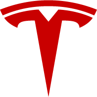

<div align="center">



# Tesla Key

**把 iPhone 变成 Tesla 的蓝牙车主钥匙，主屏幕一点就控车。**

运行在 iOS 的 Scripting App 里 · 官方 vehicle-command 蓝牙协议 · 不经过任何服务器


<br>


</div>

## 亮点

- **真正的车钥匙**：手机通过蓝牙直接和车通信，不需要 Tesla 账号、Token 或网络；私钥只存在本机钥匙串。
- **主屏幕直接控车**：解锁 / 上锁、弹开车门、前后备箱、充电口，点一下就执行；执行完自动等车辆到位再刷新状态。
- **三种尺寸小组件**：深色 / 浅色自动切换，支持系统「透明」「色调」外观；只读本地状态，不会为了刷新唤醒车辆。
- **完整 App**：车机指令（空调、座椅、充电等）、钥匙配对与管理都在 App 里完成。

<div align="center">

<br><br>

</div>

## 安装

在 Scripting 里添加远程脚本，地址填：

```
https://github.com/alexcz-a11y/tesla-key-scripting
```

在脚本设置里打开自动更新，即可随新版本更新。依赖的 npm 包（`@noble/curves`、`protobufjs`）如未自动安装，在「工具 → npm 包」里安装。

## 开始使用

1. 打开脚本 →「钥匙与设置」→「车辆与 VIN」，填写车辆 VIN。
2. 点「配对」：人在车内、钥匙卡在手边，按提示刷卡并在车机屏幕上确认。
3. 在 App 里连一次车，再添加主屏幕小组件。

小号小组件在「参数」里选部位：`lock`（默认）、`door_fl`、`door_fr`、`door_rl`、`door_rr`、`trunk`、`charge`。

## Roadmap

- 接入 TeslaMate
- 靠近自动解锁 / 离开自动上锁

## 说明

非 Tesla 官方项目，仅用于控制你自己的车，使用风险自负。

[Apache License 2.0](LICENSE)。`proto/` 下的协议定义来自 [teslamotors/vehicle-command](https://github.com/teslamotors/vehicle-command)。
